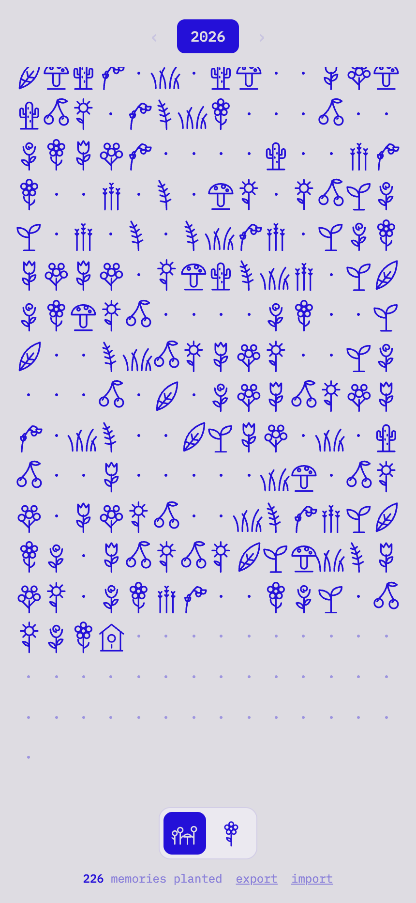
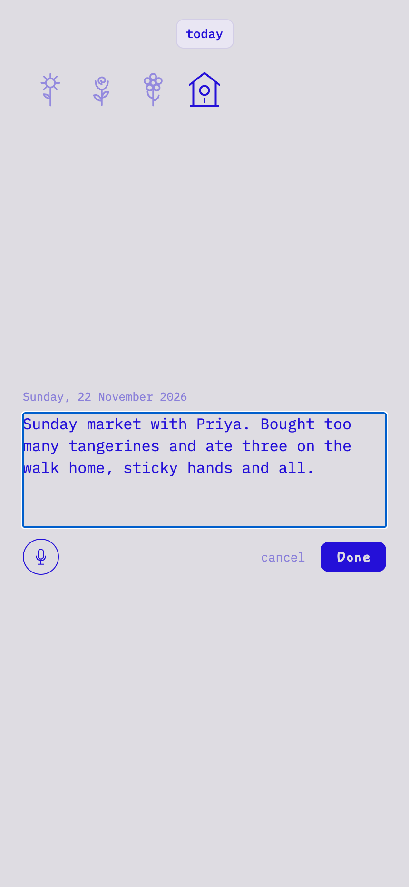

# Memory Garden

One small memory a day, grown into a garden.

  
  

One Expo / React Native codebase builds both the iPhone app and the installable web version.

- Expo Go (no voice): `npx expo start`
- With voice (speak-to-write needs a native build): `npx expo run:ios`
- TestFlight: `npx eas-cli@latest build -p ios --profile production --auto-submit`
- Web, while developing: `npx expo start --web`
- Web, for hosting: `npx expo export -p web`, then serve `dist/` from the root of any static host (e.g. `python3 -m http.server -d dist`). On Vercel, `vercel.json` already sets this up; deploy from the repo root.

The web-only files (manifest, icons, offline service worker and the HTML shell) are in `public/`. When you change `public/sw.js`, bump its `CACHE` name so installed copies update.

Press and hold a day in the garden to see its date (hover with a mouse on the web). Tap the mic in the editor to speak a memory. On the web, the mic only appears in browsers with speech recognition (Chrome, Edge and Safari).
